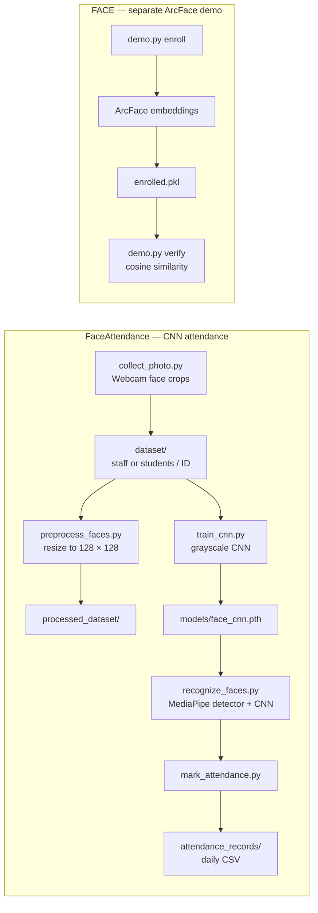

<<<<<<< HEAD
# Face Recognition and Attendance

This workspace contains two webcam-based face recognition prototypes:

1. **FaceAttendance** — a supervised PyTorch CNN that recognizes staff and students and records daily attendance in CSV files.
2. **FACE** — a separate InsightFace/ArcFace demo for enrolling identities and verifying them against stored face embeddings.

These are independent implementations with different models, data formats, and camera settings. The `FACE` demo does not feed predictions into the `FaceAttendance` attendance logger.

> **Status:** Prototype / educational project. Recognition accuracy, fairness, spoof resistance, and production readiness have not been established. Do not use this as the sole basis for consequential attendance or identity decisions.

## Contents

- [Project layout](#project-layout)
- [System overview](#system-overview)
- [FaceAttendance: installation and use](#faceattendance-installation-and-use)
- [FACE: ArcFace demo](#face-arcface-demo)
- [Data and privacy](#data-and-privacy)
- [Known limitations](#known-limitations)
- [Detailed project report](REPORT.md)

## Project layout

```text
.
├── README.md
├── REPORT.md
├── FACE/
│   ├── demo.py
│   └── enrolled.pkl
└── FaceAttendance/
    ├── collect_photo.py
    ├── mark_attendance.py
    ├── preprocess_faces.py
    ├── recognize_faces.py
    ├── requirements.txt
    └── train_cnn.py
```

Runtime folders such as `dataset/`, `processed_dataset/`, `models/`, and `attendance_records/` are created or used during operation; they were not present in the source-file inventory reviewed for this documentation.

## System overview



The diagram describes the implemented scripts. In particular, `train_cnn.py` currently reads from `dataset/` directly; it does **not** consume the `processed_dataset/` output shown in the preprocessing branch.

## FaceAttendance: installation and use

Run commands from the `FaceAttendance` directory because the dataset, model, and MediaPipe asset paths are relative to the current working directory.

### Requirements

- Python with the packages listed in [`FaceAttendance/requirements.txt`](FaceAttendance/requirements.txt)
- A webcam accessible to OpenCV
- For recognition, an internet connection the first time the MediaPipe detector asset is downloaded
- Optional CUDA-capable hardware for PyTorch GPU inference/training; CPU is also supported

On Windows, create and activate an isolated environment:

```powershell
cd FaceAttendance
py -m venv .venv
.\.venv\Scripts\Activate.ps1
python -m pip install --upgrade pip
python -m pip install -r requirements.txt
```

If PowerShell blocks virtual-environment activation, use the Python executable directly instead:

```powershell
.\.venv\Scripts\python.exe -m pip install -r requirements.txt
```

### Typical workflow

1. **Collect face images**

   ```powershell
   python collect_photo.py
   ```

   Choose staff or student, enter one of the configured IDs, then enter a name. Press **S** to save a detected face and **Q** to finish. The current per-person target is 50 images.

2. **Preprocess images (optional in the current implementation)**

   ```powershell
   python preprocess_faces.py
   ```

   This writes resized images to `processed_dataset/`. The current trainer still reads `dataset/`, so this step does not currently affect training.

3. **Train the CNN**

   ```powershell
   python train_cnn.py
   ```

   The script scans `dataset/staff/` and `dataset/students/`, creates a per-image train/validation/test split, trains with early stopping, and saves the best validation-loss checkpoint to `models/face_cnn.pth`.

4. **Run live attendance recognition**

   ```powershell
   python recognize_faces.py
   ```

   Press **Q** to exit. The camera index is configured in the script (`CAMERA_INDEX = 2` by default); adjust it if the webcam is unavailable. Daily attendance files are written under `FaceAttendance/attendance_records/`.

### Attendance behavior

- A recognized person is logged once per date, based on the local system date.
- Records are CSV files named `attendance_YYYY-MM-DD.csv`.
- The expected columns are `Person ID`, `Name`, `Date`, `Time`, and `Status`.
- Recognition uses both a minimum softmax score and a top-two score margin; these are prototype thresholds, not calibrated probabilities.

## FACE: ArcFace demo

This is a separate command-line enrollment and verification demo. Run it from the `FACE` directory:

```powershell
cd FACE
python demo.py enroll "Person Name"
python demo.py list
python demo.py verify
python demo.py delete "Person Name"
```

Enrollment captures five face samples and stores their averaged embedding in `enrolled.pkl`. Verification compares the live face embedding to enrolled embeddings using cosine similarity and the script's configured threshold. Press **R** to scan again after a match and **Q** to quit.

The root `FaceAttendance/requirements.txt` does **not** list the `insightface` dependency required by this demo. Install and validate that dependency separately in an appropriate environment before running `FACE/demo.py`; GPU/CUDA provider availability is also environment-dependent.

## Data and privacy

Face images, face embeddings, identity mappings, and attendance records are sensitive personal data. Obtain appropriate consent and authorization before collection or use. Restrict access, define retention and deletion procedures, and do not commit real datasets, model checkpoints, embeddings, or attendance exports.

The `FaceAttendance` `.gitignore` excludes its dataset, model, and attendance output directories and CSV files. The `FACE/enrolled.pkl` file is present in the workspace; treat it as potentially sensitive biometric data and verify repository tracking/access before sharing this project.

## Known limitations

- No verified accuracy, latency, false-accept, or false-reject results are included; there is no documented evaluation dataset or test report.
- The CNN training script reads raw `dataset/` even though preprocessing writes `processed_dataset/`.
- The demo and attendance application use different identity stores and recognition pipelines.
- The ArcFace dependency is not declared in the available requirements file.
- Camera index `2` is hard-coded in the attendance capture and recognition scripts; the ArcFace demo uses index `0`.
- The attendance name mapping is embedded in source code and must be kept private and synchronized with the collected identities.
- The systems do not implement liveness detection or presentation-attack defenses.

See [REPORT.md](REPORT.md) for the implementation analysis, risks, and recommended next steps.
=======
# Face-Recognition-Attendance-System
Face Recognition Based Attendance Management System — Internship Project
>>>>>>> 7acd21dfb3288088bcdf8f8a1de85b1eaa447a44
