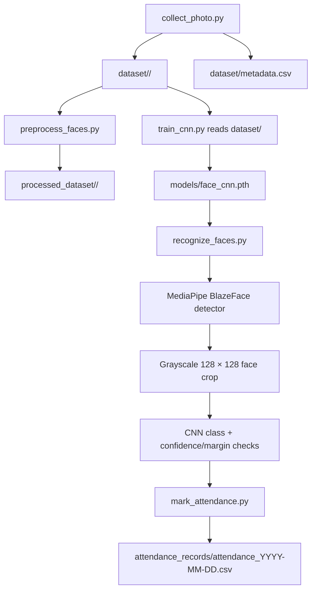
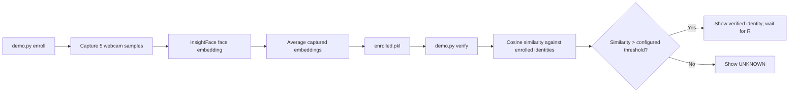

# Face Recognition and Attendance System
## Project Analysis Report

**Document type:** Implementation and readiness review  
**Scope:** Source files present in `FACE/` and `FaceAttendance/`  
**Assessment basis:** Static inspection of the available project files; no dataset-based execution or model benchmark was performed.

---

## 1. Executive summary

This workspace contains two independent webcam face-recognition prototypes:

- **FaceAttendance** implements image collection, a grayscale convolutional neural network (CNN), live webcam classification, and date-based CSV attendance logging.
- **FACE** implements identity enrollment and verification with InsightFace/ArcFace embeddings persisted in a pickle file.

The attendance flow has a recognizable end-to-end structure, but one workflow integration gap is material: preprocessing writes to `processed_dataset/`, while training reads from `dataset/`. Consequently, running the preprocessing step does not currently prepare the data consumed by the trainer. The two implementations also have different enrollment formats and cannot share models or identity data as currently written.

The code contains configurable thresholds and train/validation/test splitting, but no empirical results are provided. Therefore, recognition accuracy and operational reliability cannot be asserted from this review. The systems should be treated as prototypes and not as sole decision-makers for real attendance or identity verification.

### At-a-glance assessment

| Area | Implemented | Evidence-based assessment |
|---|---|---|
| Image acquisition | Yes | Interactive webcam collection and face crops in `FaceAttendance/collect_photo.py` |
| Image preprocessing | Yes | Resize pipeline exists, but its output is not consumed by the trainer |
| Model training | Yes | Custom grayscale CNN, augmentation, class weights, scheduler, and early stopping |
| Live recognition | Yes | MediaPipe face detector plus CNN classification in the attendance pipeline |
| Attendance persistence | Yes | Daily CSV files with duplicate-per-day suppression |
| Alternate recognition demo | Yes | ArcFace enrollment, embedding comparison, list and delete commands |
| Measured model quality | Not supplied | No dataset results, confusion matrix, or independently verified benchmark |
| Production safeguards | Incomplete | No liveness defense, calibrated validation, access-control design, or operational monitoring |

## 2. Scope and source inventory

### `FaceAttendance/`

| File | Responsibility |
|---|---|
| `collect_photo.py` | Selects staff/student identity, detects a face using OpenCV Haar cascades, captures manually selected crops, and appends metadata |
| `preprocess_faces.py` | Reads images under `dataset/`, resizes them to 128 × 128, and writes them under `processed_dataset/` |
| `train_cnn.py` | Loads identity folders from `dataset/`, splits images, trains/evaluates a CNN, and saves a checkpoint |
| `recognize_faces.py` | Loads the checkpoint, detects faces with MediaPipe, classifies them, applies thresholds, and calls the attendance logger |
| `mark_attendance.py` | Writes one attendance row per identity per local date to a CSV file |
| `requirements.txt` | Declares PyTorch, torchvision, OpenCV, NumPy, and MediaPipe dependencies |

### `FACE/`

| File | Responsibility |
|---|---|
| `demo.py` | CLI for webcam enrollment, verification, listing, and deletion using InsightFace/ArcFace |
| `enrolled.pkl` | Existing serialized enrollment database; its contents were not inspected as a data artifact |

The project also contains an environment and Git metadata under the `FACE` folder. The source layout does not show a shared package, test suite, or unified project configuration.

## 3. Architecture and implemented flow

### 3.1 Attendance pipeline

`processed_dataset/` is currently a terminal branch: it is generated but not read by `train_cnn.py`. The trainer instead reads the original `dataset/` folders and performs its own grayscale resizing during loading.

### 3.2 ArcFace demo

This is not connected to the attendance CSV pipeline. It has a separate stored identity database, threshold, camera configuration, and runtime dependency.

## 4. Technical implementation analysis

### 4.1 Image collection

The collection script:

- supports two categories, staff and students, with configured identity IDs;
- uses OpenCV's frontal-face Haar cascade;
- selects the largest detected face in the frame;
- allows a user to manually save a detected crop using the **S** key;
- adds a margin and resizes saved crops to 128 × 128;
- writes images to `dataset/<category>/<person_id>/` and metadata to `dataset/metadata.csv`;
- counts existing JPEGs to allow a collection session to resume.

The configured target is 50 images per person. A code comment mentions increasing it to 300 after testing, but that change is not active. Image quality, pose diversity, lighting variation, and train/test subject leakage should be reviewed as part of an evaluation process.

### 4.2 Preprocessing and training

The CNN trainer:

- scans staff and student identity folders under `dataset/`;
- constructs class labels from category and person ID;
- shuffles images with a fixed Python/NumPy/Torch seed;
- creates a per-identity split with nominal targets of 70% train, 15% validation, and the remainder test;
- converts images to grayscale and resizes to 128 × 128;
- applies training augmentation including horizontal flip, small rotation/scale changes, and brightness/contrast changes;
- uses a four-stage convolutional feature extractor and a fully connected classifier;
- applies class-weighted cross-entropy, AdamW, and a validation-loss learning-rate scheduler;
- saves the best validation-loss checkpoint and stops early after a configured patience.

The final test accuracy is printed by the script, but no output from an actual training run is included in the reviewed materials. There are also no saved evaluation charts or confusion matrix, so no quality conclusion can be reported.

**Data-split caution:** Splitting images independently within each identity is appropriate for a closed-set identity classifier, but near-duplicate captures or adjacent video frames can produce overly optimistic test results. A robust evaluation should separate capture sessions and vary conditions, then report per-identity and aggregate metrics. For an open-set attendance scenario, include people who are not enrolled.

### 4.3 Live attendance recognition

The recognition program loads the CNN checkpoint and MediaPipe's BlazeFace detector. It converts each detected face crop to grayscale, resizes it to 128 × 128, normalizes pixel values, and classifies it with the CNN.

A prediction is accepted only if both conditions pass:

- top softmax score is at least `0.85`;
- difference between the top and second class scores is at least `0.20`.

These are configured rejection heuristics, not statistically calibrated confidence guarantees. A closed-set softmax classifier can assign high scores to an identity even when the face is not enrolled. Thresholds must be selected and evaluated against representative known-person and unknown-person data.

### 4.4 Attendance records

`mark_attendance.py` writes a daily CSV with person ID, name, date, time, and status. It searches the current day's file to prevent a second row for the same ID and returns whether a new row was added. Timestamps use the machine's local clock.

This is a simple local prototype storage design. It does not provide concurrent-write protection, tamper evidence, role-based access, retention management, or a transactional audit trail.

### 4.5 ArcFace enrollment and verification

The `FACE/demo.py` script uses InsightFace's `buffalo_l` model with CUDA and CPU execution providers configured. It captures five enrollment samples, averages their embeddings, persists the identity-to-embedding mapping using Python pickle, and verifies live faces by cosine similarity. It selects the largest face when a frame contains multiple faces and locks on a positive match until the user resets the scan.

The configured similarity threshold is `0.5`, with a code comment indicating it should be tuned. No measured threshold analysis is supplied. Loading pickle data is unsafe if the file can be replaced by an untrusted party; only load a trusted enrollment file. Embeddings are biometric identifiers and should receive protection comparable to the original face images.

## 5. Important integration and configuration findings

1. **Preprocessing output is disconnected from training.** `preprocess_faces.py` writes `processed_dataset/`; `train_cnn.py` reads `dataset/`. The README documents this behavior rather than implying preprocessing is part of the actual training path.
2. **Two separate applications are present.** The ArcFace demo does not call `mark_attendance.py`, and its enrollment file cannot be used directly by the CNN attendance app.
3. **The available dependency list is incomplete for the demo.** `FaceAttendance/requirements.txt` includes packages for the attendance pipeline but not `insightface`, which `FACE/demo.py` imports.
4. **Working directory affects relative paths.** The attendance dataset, checkpoint, and detector asset paths are relative to the working directory. Launch those scripts from `FaceAttendance/`. The attendance CSV path is instead anchored to the script directory.
5. **Camera indices differ.** Attendance collection/recognition default to camera index 2; the ArcFace demo opens camera index 0.
6. **Identity data is embedded in code.** The attendance name mapping is hard-coded in `mark_attendance.py`; avoid publishing real identity details and ensure IDs, names, and collected classes remain consistent.
7. **Model artifacts are not reproducibly specified.** The ArcFace runtime may download its model, and the MediaPipe detector asset is downloaded by the attendance recognition program. Versions, checksums, and model provenance are not captured in a lockfile.

## 6. Privacy, security, and responsible-use considerations

The project processes face images, biometric embeddings, identity-to-name mappings, and attendance history. These data can identify people and reveal their presence at a place or time.

Recommended safeguards before real-world use:

- collect only with appropriate consent, authorization, and notice;
- establish a documented purpose, retention schedule, and deletion process;
- restrict file-system and repository access to images, embeddings, models, and attendance CSVs;
- exclude runtime personal data and biometric artifacts from commits and shared archives;
- review repository tracking and access for the existing `FACE/enrolled.pkl`;
- provide a manual correction and appeal path for false matches or missed attendance;
- do not treat a face match as proof of identity without additional safeguards;
- assess demographic performance and environmental robustness on an appropriately governed evaluation set;
- evaluate presentation-attack/liveness risks; neither pipeline implements liveness detection.

The `FaceAttendance` `.gitignore` excludes its dataset, processed data, model, attendance records, and CSV files. Repository-level protection for `FACE/enrolled.pkl` should be verified separately.

## 7. Validation status and results

### Validation performed for this report

- Inspected the available Python source and dependency manifest.
- Traced data paths and runtime flows across collection, preprocessing, training, recognition, and attendance logging.
- Reviewed the separate ArcFace demo's CLI and storage behavior.

### Not available / not performed

- No actual webcam execution or device compatibility check.
- No dependency installation or environment compatibility test.
- No training run, test-set evaluation, or accuracy verification.
- No privacy, fairness, spoofing, or security test.
- No recorded benchmark, dataset-size inventory, or confusion matrix.

Accordingly, there are **no measured performance results** to visualize. Reporting a chart or accuracy value without running a controlled evaluation would be misleading.

## 8. Recommended next steps

### Priority 1 — make the workflow unambiguous

- Decide whether preprocessing is required. Either train from `processed_dataset/` or remove the redundant preprocessing step and document training's in-memory transformations.
- Define a single documented entry point and consistent working-directory behavior.
- Choose whether the deliverable is the CNN attendance application, the ArcFace demo, or both; integrate only after selecting a deliberate common identity and attendance architecture.
- Record all dependencies for each application and test supported Python/platform combinations.

### Priority 2 — establish trustworthy evaluation

- Capture a consented dataset with varied sessions, lighting, pose, distance, and camera conditions.
- Keep capture sessions separated across training, validation, and test partitions where feasible.
- Include unknown identities and report false-accept and false-reject rates alongside accuracy.
- Report per-identity confusion, sample counts, threshold choices, and device/latency details.
- Validate threshold performance on data not used for training or model selection.

### Priority 3 — strengthen data handling

- Move identity mappings out of source code and protect them as configuration/records.
- Define consent, retention, access, deletion, and incident-response procedures.
- Ensure biometric files such as `enrolled.pkl` are excluded from public version control and backups are appropriately protected.
- Consider replacing untrusted pickle loading with a safer, versioned data format.

### Priority 4 — improve operational reliability

- Add tests for data discovery, model/checkpoint compatibility, threshold decisions, and duplicate attendance behavior.
- Add clear handling for unreadable images, camera failures, missing assets, and unwritable output paths.
- Test camera indices and CPU-only execution on target devices.
- Add an audited correction process and avoid fully automated attendance decisions without human review.

## 9. Conclusion

The workspace demonstrates two useful prototype directions: a custom trainable identity classifier with CSV attendance recording, and an embedding-based ArcFace verification demo. The attendance workflow is structurally complete enough for controlled experimentation, but the unused preprocessing output, incomplete demo dependency declaration, and absence of evaluation evidence should be addressed before relying on its results. Because the code processes biometric and attendance data, privacy controls and measured false-match performance are prerequisites for any deployment beyond experimentation.

---

*This report describes the files available at review time. It is not a certification of accuracy, security, fairness, legal compliance, or production readiness.*
